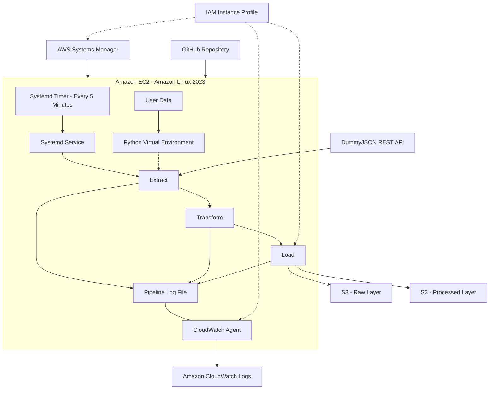

cat > README.md <<'EOF'
# EC2-Based Automated Data Pipeline

An automated batch ETL pipeline running on Amazon EC2,
using Python, Amazon S3, IAM, AWS Systems Manager,
systemd, and Amazon CloudWatch.

## Architecture



## Project Objectives

- Run a batch data pipeline on Amazon EC2.
- Automate instance initialization using User Data.
- Manage EC2 without SSH or inbound ports.
- Access AWS services using IAM temporary credentials.
- Schedule ETL workloads using systemd timers.
- Centralize application logs in CloudWatch.
- Observe pipeline failures and recovery.

## Technology Stack

| Technology | Purpose |
|---|---|
| Amazon EC2 | Compute infrastructure |
| Amazon Linux 2023 | Operating system |
| Amazon S3 | Raw and processed data storage |
| AWS IAM | Identity and access management |
| AWS Systems Manager | Secure remote administration |
| Amazon CloudWatch | Centralized logging |
| Python | ETL implementation |
| Boto3 | AWS SDK |
| Requests | REST API integration |
| systemd | Service management and scheduling |
| GitHub | Source control and deployment |

## Data Pipeline

### Extract

Retrieve product data from the DummyJSON REST API.

### Transform

- Select relevant product attributes.
- Filter missing prices and stock values.
- Filter negative prices and stock values.
- Rename fields.
- Calculate inventory value.

Inventory value = price x stock

### Load

Store raw and transformed JSON datasets in Amazon S3.

Each execution creates timestamped objects:

```text
raw/
    <timestamp>/products.json

processed/
    <timestamp>/products.json
```

## Infrastructure Configuration

| Component | Configuration |
|---|---|
| AWS Region | eu-central-1 |
| Instance Type | t3.micro |
| Architecture | x86_64 |
| Operating System | Amazon Linux 2023 |
| Storage | 10 GiB encrypted gp3 |
| Inbound Rules | None |
| Remote Access | SSM Session Manager |
| Scheduling | Every 5 minutes |
| Log Retention | 1 day |

## Repository Structure

```text
.
├── infrastructure/
│   ├── user-data.sh
│   ├── iam-policy.json
│   ├── data-pipeline.service
│   ├── data-pipeline.timer
│   └── amazon-cloudwatch-agent.json
├── src/
│   └── pipeline.py
├── requirements.txt
├── README.md
├── LICENSE
└── .gitignore
```

## Deployment

1. Create a private S3 bucket with public access blocked.
2. Update the bucket name in the Python application
   and IAM policy if necessary.
3. Create an IAM role trusted by Amazon EC2.
4. Attach the custom S3 policy and the following
   AWS-managed policies:
   - AmazonSSMManagedInstanceCore
   - CloudWatchAgentServerPolicy
5. Launch an Amazon Linux 2023 EC2 instance.
6. Attach the IAM instance profile.
7. Configure User Data using infrastructure/user-data.sh.
8. Allow outbound connectivity without inbound rules.
9. Connect using SSM Session Manager.
10. Install Git and clone the repository.
11. Execute the pipeline manually.
12. Configure the systemd service and timer.
13. Configure and start the CloudWatch Agent.

### Application Deployment

```bash
sudo dnf install -y git

sudo -u ec2-user git clone \
https://github.com/MrEktirir/aws-ec2-automated-data-pipeline.git \
/opt/data-pipeline/app
```

### Manual Execution

```bash
sudo -u ec2-user /opt/data-pipeline/venv/bin/python \
/opt/data-pipeline/app/src/pipeline.py
```

### Automated Scheduling

```bash
sudo mkdir -p /var/log/data-pipeline

sudo cp /opt/data-pipeline/app/infrastructure/data-pipeline.service \
/etc/systemd/system/

sudo cp /opt/data-pipeline/app/infrastructure/data-pipeline.timer \
/etc/systemd/system/

sudo systemctl daemon-reload
sudo systemctl enable --now data-pipeline.timer
```

### CloudWatch Configuration

```bash
sudo cp /opt/data-pipeline/app/infrastructure/amazon-cloudwatch-agent.json \
/opt/aws/amazon-cloudwatch-agent/etc/

sudo /opt/aws/amazon-cloudwatch-agent/bin/amazon-cloudwatch-agent-ctl \
-a fetch-config \
-m ec2 \
-c file:/opt/aws/amazon-cloudwatch-agent/etc/amazon-cloudwatch-agent.json \
-s
```

CloudWatch Log Group:

`/ec2/data-pipeline`

Each EC2 instance uses its instance ID as the log stream name.

## Execution Results

The initial manual execution successfully processed
194 products and uploaded two JSON objects to S3.

| Metric | Observed Result |
|---|---|
| Extracted Products | 194 |
| Transformed Products | 194 |
| S3 Objects | 2 |
| Initial Execution Duration | 329 ms |
| IAM Authentication | Successful |
| Automated Scheduling | Successful |
| CloudWatch Integration | Successful |

## Failure and Recovery

A controlled DNS failure was introduced by temporarily
changing the API endpoint to an invalid domain.

The pipeline failed during extraction, and the exception
was captured in Amazon CloudWatch Logs.

The original application was restored using Git.

The next scheduled execution completed successfully
without manually restarting the pipeline.

This demonstrates failure detection, manual remediation,
and recovery through scheduled execution.

## Security

- No inbound security group rules.
- No SSH key pair required.
- Remote administration through SSM Session Manager.
- Temporary AWS credentials through an IAM instance profile.
- S3 public access blocked.
- Encrypted EBS storage.
- Application execution under a non-root user.
- Bucket-scoped custom S3 permissions.

## Resource Cleanup

After completing the project, the project resources
were removed:

- EC2 instance
- EBS volume
- S3 bucket and objects
- CloudWatch log group
- Security group
- IAM role
- Custom IAM policy

## Limitations

This project is an educational implementation.

- Single EC2 instance without high availability.
- Public IPv4 address for outbound connectivity.
- No automatic application-level retry mechanism.
- No automated failure remediation.
- No CloudWatch alarms.
- No infrastructure-as-code provisioning.
- Python dependencies are not version-pinned.
- The original environment used Python 3.9,
  which generated a Boto3 deprecation warning.
- The five-minute schedule is intended for demonstration.

## License

MIT License.
EOF